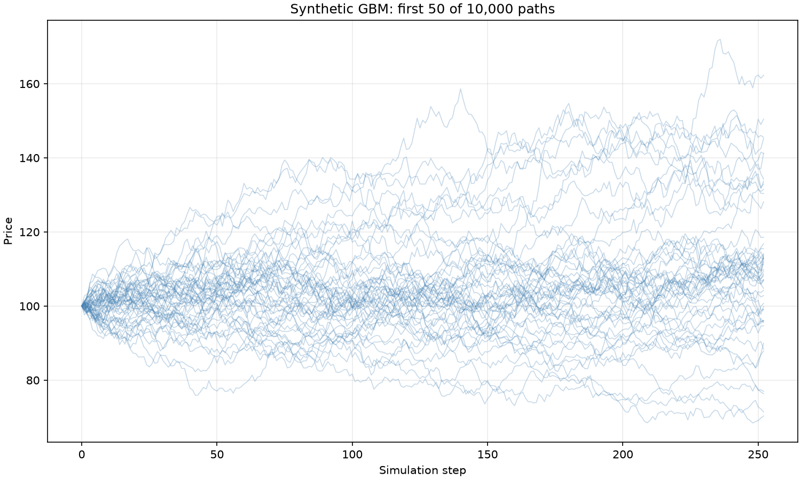
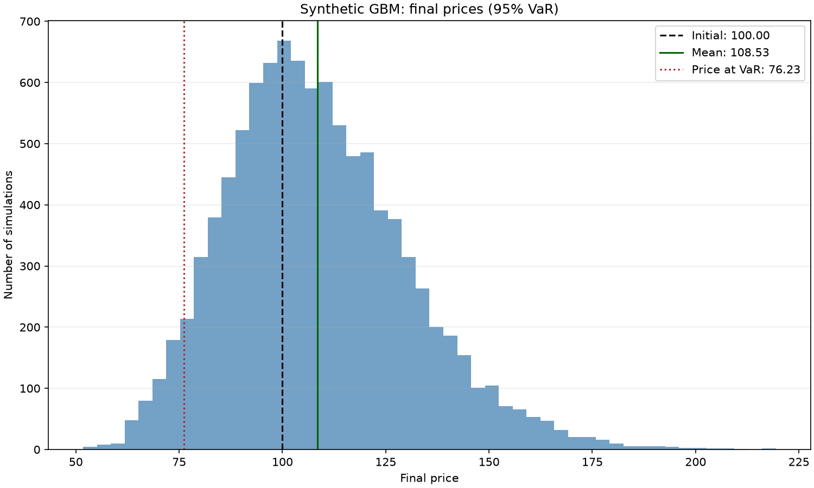

# Monte Carlo Price Simulator

A Python implementation of a Monte Carlo simulator for asset prices, based on **Geometric Brownian Motion (GBM)**. The project estimates model parameters from real historical market data, simulates thousands of possible future price paths, and derives risk metrics such as **Value at Risk (VaR)** and **Conditional Value at Risk (CVaR)** from the simulated outcomes.

This repository is part of my self-directed study path in **quantitative finance**. The goal is to build every component from first principles, understanding the mathematics behind each step instead of relying on black-box libraries.

> **Status:** Under active development. See the [Roadmap](#roadmap) for what is implemented and what is planned.

---

## Table of Contents

- [Motivation](#motivation)
- [Features](#features)
- [Mathematical Background](#mathematical-background)
- [Project Structure](#project-structure)
- [Getting Started](#getting-started)
- [Usage](#usage)
- [Methodology](#methodology)
- [Roadmap](#roadmap)
- [Limitations](#limitations)
- [Tech Stack](#tech-stack)
- [Disclaimer](#disclaimer)
- [License](#license)

---

## Motivation

Monte Carlo methods are a cornerstone of quantitative finance. They are used for derivatives pricing, portfolio risk management, scenario analysis, and stress testing. When closed-form solutions do not exist, simulation provides a flexible and general way to approximate the distribution of future outcomes.

This project aims to:

1. Implement a GBM-based price simulator that is correct, vectorized, and reproducible.
2. Calibrate the model with real market data (expected return and volatility).
3. Quantify uncertainty using statistical tools: confidence intervals, percentiles, and tail-risk measures.
4. Serve as a solid foundation for more advanced work: option pricing, correlated multi-asset simulation, and variance reduction techniques.

---

## Features

**Implemented (single asset GBM)**

- Simulation of asset price paths under Geometric Brownian Motion
- Vectorized implementation with NumPy for performance
- Reproducible results through seeded random number generation
- Parameter estimation (annualized drift and volatility) from historical prices
- Historical data download via `yfinance`
- Saved path fan charts and terminal-price histograms, with optional display
- Analytical validation of terminal mean, sample variance and 5%/50%/95% quantiles
- Nested-sample convergence analysis and saved error charts
- Optional chronological historical forecasts with frozen calibration and observed VaR coverage
- JSON reports containing historical snapshots and offline replay
- Risk metrics: Value at Risk (VaR) and Conditional Value at Risk (CVaR / Expected Shortfall)

**Planned**

- European option pricing via Monte Carlo, validated against the Black-Scholes closed-form solution
- Variance reduction techniques (antithetic variates, control variates)
- Confidence intervals
- Multi-asset simulation with correlated returns (Cholesky decomposition)
- Configuration files

---

## Mathematical Background

### Geometric Brownian Motion

Under GBM, the asset price $S_t$ follows the stochastic differential equation:

$$
dS_t = \mu S_t \, dt + \sigma S_t \, dW_t
$$

where:

| Symbol | Meaning |
|--------|---------|
| $S_t$ | Asset price at time $t$ |
| $\mu$ | Expected annualized return (drift) |
| $\sigma$ | Annualized volatility |
| $W_t$ | Standard Wiener process (Brownian motion) |

Applying Itô's lemma yields the exact solution:

$$
S_t = S_0 \exp\left( \left(\mu - \frac{\sigma^2}{2}\right) t + \sigma W_t \right)
$$

### Discretization

For a time step $\Delta t$, prices are simulated recursively with the exact discretization:

$$
S_{t+\Delta t} = S_t \exp\left( \left(\mu - \frac{\sigma^2}{2}\right) \Delta t + \sigma \sqrt{\Delta t} \, Z \right), \qquad Z \sim \mathcal{N}(0, 1)
$$

Because this is the exact solution of the SDE, it introduces no discretization error, unlike the Euler-Maruyama scheme.

### Parameter Estimation

Given a series of historical prices, daily log returns are computed as:

$$
r_t = \ln\left(\frac{S_t}{S_{t-1}}\right)
$$

With 252 trading days per year, the annualized parameters are estimated as:

$$
\hat{\sigma} = \sqrt{252} \cdot \text{std}(r_t), \qquad \hat{\mu} = 252 \cdot \text{mean}(r_t) + \frac{\hat{\sigma}^2}{2}
$$

### Monte Carlo Estimation and Error

For $N$ independent simulations, the expected value of a quantity $X$ is estimated by the sample mean $\bar{X}$. The standard error shrinks at a rate of $1/\sqrt{N}$:

$$
\text{SE} = \frac{s}{\sqrt{N}}
$$

where $s$ is the sample standard deviation. This is why convergence analysis and variance reduction techniques matter in practice.

### Risk Metrics

- **Value at Risk (VaR)** at confidence level $\alpha$: the loss threshold that is not exceeded with probability $\alpha$ over the chosen horizon, estimated as the corresponding percentile of the simulated loss distribution.
- **Conditional Value at Risk (CVaR)**: the mean simulated loss greater than or equal to the VaR threshold, including all ties at VaR.

---

## Project Structure

```
monte-carlo-gbm/
├── README.md
├── pyproject.toml
├── main.py                  # Simulation and replay CLI
├── src/
│   ├── simulation/          # GBM paths, plots and JSON reports
│   ├── calibration/         # Historical prices, parameter estimates and fundamentals
│   ├── risk/                # Terminal loss statistics
│   └── validation/          # Analytical GBM benchmarks and convergence
├── tests/                   # Offline tests, including test_gbm.py and test_statistics.py
├── notebooks/research.ipynb # Empty research workspace
├── research/report.md       # Research questions; no experimental results
└── figures/                 # Existing synthetic example charts and future figures
```

A run named by `--report reports/simulation.json` writes four files under
`reports/simulation/`: `report.json`, `convergence.png`, `paths.png`, and
`final-distribution.png`. The `reports/` directory is ignored by Git.

---

## Getting Started

### Prerequisites

- Python 3.10 or newer
- `pip` and `venv`

### Installation

```bash
# Clone the repository
git clone https://github.com/s2ddv/monte-carlo-gbm.git
cd monte-carlo-gbm

# Create and activate a virtual environment
python3 -m venv .venv
source .venv/bin/activate        # Linux / macOS
# .venv\Scripts\activate         # Windows

# Install dependencies
pip install -e .
```

---

## Usage

Run the application and enter the stock you want to analyze when prompted:

```bash
python main.py
```

For example, enter `AAPL`, `MSFT`, `PETR4.SA` or `VALE3.SA`. Input is trimmed
and uppercased; Brazilian shorthand such as `PETR4` becomes `PETR4.SA`.
For other exchanges, supply the Yahoo Finance suffix explicitly (e.g. `SAP.DE`).
Blank input or multiple symbols prompt again. There is no default stock.

To run without opening a chart, or to choose simulation parameters:

```bash
python main.py --ticker PETR4.SA --period 3y --horizon 1 --steps 252 --n-sims 1000 --confidence 0.95 --no-plot
```

Use `python main.py --help` for all options. A new simulation downloads historical
prices and company fundamentals and requires network access. `--ticker` skips
the prompt, including for scripts and CI. If stdin ends before a ticker is
provided, the CLI explains how to use `--ticker` and exits. `--no-plot` suppresses
interactive windows; it still saves the JSON report and all three PNG figures.
The report name selects a sibling run directory (the `.json` suffix is removed).
If either the requested JSON path or run directory already exists, the command
fails and asks for another name. It never replaces an existing run. Files are
prepared in a temporary sibling directory; a figure or JSON write failure
removes that directory and leaves no apparently complete report.

### Price charts

`plot_paths` displays the first 50 paths by default, including the initial row.
Its horizontal axis is the simulation step, since the path matrix does not
contain the horizon. `plot_final_distribution` uses every terminal price and
marks the initial price, mean and optional price at VaR (`s0 - var`).
Both functions return a Matplotlib figure, accept an optional title and save
path, and leave display and closing to the caller.

These examples use synthetic parameters, not downloaded market data:
`s0=100`, `mu=0.08`, `sigma=0.20`, one year, 252 steps, 10,000 simulations,
seed 42 and 95% VaR confidence. Reproduce them offline from the repository root:

```bash
PYTHONPATH=src MPLBACKEND=Agg python - <<'PY'
import matplotlib.pyplot as plt
from simulation.gbm import simulate_gbm
from simulation.plotting import plot_final_distribution, plot_paths
from risk.statistics import risk_summary

paths = simulate_gbm(100, 0.08, 0.20, 1, 252, 10_000, seed=42)
risk = risk_summary(paths, confidence=0.95)
fan = plot_paths(paths, title="Synthetic GBM: first 50 of 10,000 paths",
                 save_path="figures/example-paths.png")
histogram = plot_final_distribution(
    paths, var=risk["var"], title="Synthetic GBM: final prices (95% VaR)",
    save_path="figures/example-final-distribution.png",
)
plt.close(fan)
plt.close(histogram)
PY
```





### Company analysis

Before the GBM simulation, a Portuguese terminal summary displays 30 indicators:

| Area | Indicators |
| --- | --- |
| Market and valuation | Quote, market capitalization, enterprise value (EV), trailing and forward P/E (P/L), P/B (P/VP), P/S, EV/revenue, EV/EBITDA |
| Results and growth | Revenue, net income attributable to common shareholders, EBITDA, quarterly year-over-year revenue and earnings growth |
| Profitability | Gross, operating and net margins; ROE and ROA |
| Cash and financial position | Operating and free cash flow, total cash and debt, current and quick ratios |
| Dividends and market risk | Trailing annual dividend yield, payout ratio, beta, 52-week low and high |

The source is [Yahoo Finance through `yfinance.Ticker.get_info`](https://ranaroussi.github.io/yfinance/reference/api/yfinance.Ticker.get_info.html).
The summary includes the company name, sector, industry, retrieval time in UTC,
quote time and most recent quarter end when supplied. Trading and financial
statement currencies are shown separately; amounts are unabridged, with comma
thousands separators and decimal points. Missing currencies are explicitly
unknown. TTM means trailing twelve months; forward P/E is a provider estimate,
and growth compares a quarter with the same quarter of the previous year.
The provider may use different reference dates across fields; a retrieval
timestamp does not imply that every metric was updated at that time.

These are common equity-analysis categories, including the price and enterprise
multiples discussed by [CFA Institute](https://www.cfainstitute.org/insights/professional-learning/refresher-readings/2026/market-based-valuation-price-enterprise-value-multiples).
Compare companies within their sector and inspect their financial statements;
there is no universal “Wall Street” threshold that makes a stock cheap or good.
Market cap and EV are market valuations, not a calculated intrinsic fair value.
This feature does not perform DCF, comparable-company selection or issue a
buy/sell recommendation. The existing GBM output remains a separate price-risk
simulation and does not use these fundamentals to estimate fair value.

Missing, nonfinite or inapplicable data appears as `N/D` (`null` in JSON), never
as a fabricated zero. Actual zero and negative cash flow/margins are preserved.
P/E, P/B and EV/EBITDA are suppressed when the provider reports a nonpositive
denominator or multiple. Percent fields use the provider's fractional units;
dividend yield specifically uses `trailingAnnualDividendYield`. Ratios are
provider-reported, with no local FX conversion or recomputation from potentially
incompatible currencies. Non-equity instruments receive a warning because
company metrics may not apply. A fundamentals-provider failure is shown explicitly
and the price simulation can still run; missing price history stops it with an
actionable error.

### Reproducible reports

```bash
python main.py --ticker PETR4.SA --period 3y --horizon 1 --steps 252 --n-sims 10000 --seed 42 --no-plot --report reports/petr4.json
python main.py --replay reports/petr4/report.json --no-plot --report reports/petr4-replay.json
```

The first command writes `reports/petr4/report.json` and three PNG files in
`reports/petr4/`. The second uses the saved historical observations
and simulation configuration, without downloading data. In replay mode, ticker,
period, horizon, steps, simulations, confidence and seed come from the report;
any corresponding CLI flags are ignored. Use a different output path to retain
the original report.

Price history comes from `yfinance.download` with `auto_adjust=True` and the
single ticker's daily `Close` series. The provider response must have unique,
ordered dates and at least three positive finite prices. Missing or ambiguous
columns, invalid dates and invalid prices stop the run with a descriptive error.
The snapshot records `source: yfinance`, `price_field: adjusted_close`, daily
interval and the exact observations; replay uses these saved prices offline.

The JSON records:

- Ticker, requested historical period, source, daily adjusted-close convention,
  retrieval timestamp (with timezone), first/last observation dates and count.
- Every historical close and its date, plus a SHA-256 checksum of that snapshot.
- Last observed price, estimated annual drift and volatility, 252 trading days
  per year and the standard-deviation convention used in calibration.
- Horizon in years, steps, simulation count, seed and risk confidence level.
- Simulated and theoretical mean, variance and quantiles, with absolute and
  relative errors, risk metrics and every convergence checkpoint.
- Python and relevant package versions, RNG and numerical conventions.
- `company_analysis`: company identity, source URL, retrieval/reference dates,
  currencies, each metric's provider field, value, period and availability reason.

Replay restores the saved company analysis without prompting or accessing the
provider. Its original retrieval time remains visible; these are historical
snapshots, not refreshed quotes. Older reports without `company_analysis`
continue to replay and explicitly state that no fundamentals were saved.

The snapshot preserves the inputs even when the provider revises adjusted
prices. Replay recalibrates parameters and recomputes results from those inputs.
Identical numerical results require the same code and numerical environment;
a seed alone does not guarantee equality across NumPy versions. The report
records versions but does not install or pin them. The checksum detects changes
to the stored observations; it does not authenticate the provider.

### Analytical validation and convergence

For fixed calibrated parameters, the terminal law is
`log(S_T) ~ Normal(log(S_0) + (mu - sigma²/2) T, sigma² T)`. Thus:

- Mean: `S_0 exp(mu T)`.
- Variance: `S_0² exp(2 mu T) expm1(sigma² T)`.
- Quantile at probability `p`: `S_0 exp((mu - sigma²/2) T + sigma sqrt(T) Phi⁻¹(p))`.

These are the [lognormal formulas documented by NIST](https://www.itl.nist.gov/div898/handbook/eda/section3/eda3669.htm),
parameterized for GBM. `mu` is the price drift, not the mean log return.
`expm1` improves precision for small volatility. The zero-volatility case is a
point mass and is handled directly. Empirical variance uses `ddof=1` (unbiased);
quantiles use NumPy's linear interpolation at 5%, 50% and 95%. Quantiles describe
the terminal distribution, not confidence intervals for an estimator.

Absolute error is `abs(estimate - theory)`; relative error divides that by
`abs(theory)`. Undefined values are JSON `null`: sample variance at `N=1`, and
relative error when the theoretical reference is zero. A single simulation is
supported but cannot demonstrate convergence.

Up to 12 geometrically spaced checkpoints reuse increasing prefixes of the
**same terminal sample**, always including the full sample. The three-panel PNG
shows absolute errors for mean, variance and quantiles. Its mean panel also
shows `sqrt(Var(S_T)/N)`, the exact standard error (and RMSE) of the sample mean
under fixed GBM parameters. This reference decays as `N^(-1/2)`; one observed
error curve need not decrease monotonically. Checkpoints are correlated because
the samples are nested; they are not independent replications or an empirical
RMSE study. The plot uses a logarithmic N axis and linear error axes so zero
errors remain visible. Variance errors have squared-price units.

The simulator uses exact GBM increments, so this measures Monte Carlo sampling
error, not time-discretization error. Calibration uncertainty and model mismatch
are not included. Holding the seed fixed while changing the array shape
(`steps` or `n_sims`) changes which random draws belong to each path; separate
runs should not be interpreted as nested samples.

### Chronological historical validation

Enable this separate diagnostic explicitly:

```bash
python main.py --ticker PETR4.SA --period 3y --out-of-sample --calibration-observations 504 --evaluation-horizon-days 21 --evaluation-confidence 0.95 --no-plot --report reports/petr4-oos.json
python main.py --replay reports/petr4-oos/report.json --no-plot --report reports/petr4-oos-replay.json
```

The first `n` adjusted closes calibrate `mu` and `sigma` **once** using 252 trading
observations per year and the sample standard deviation of daily log returns
(`ddof=1`). At least three calibration closes and one complete evaluation horizon
are required. The first forecast begins at close `n-1`; later origins are
`n-1+k*h`, each targeting a close `h` observations later. Thus scored intervals
do not overlap. Remaining observations shorter than `h` are counted but not
scored. An origin may use its own known price; no later price enters calibration.

For each origin price `S`, horizon `T=h/252` years, and confidence `alpha`, the
GBM predicts mean `S exp(mu*T)`, median `S exp((mu-sigma²/2)*T)`, and lower
quantile `Q = S exp((mu-sigma²/2)*T + sigma*sqrt(T)*Phi⁻¹(1-alpha))`.
Predicted `VaR_alpha = S-Q`; realized loss is `S-S_realized`. A violation occurs
only when realized loss is **strictly greater** than VaR, equivalently
`S_realized < Q`. The observed violation count and rate are shown beside the
nominal reference `1-alpha`; these describe historical observed coverage, not
future predictive validity or proof of risk calibration.

The point forecast is the predicted mean. Each error is `S_realized-S_predicted`.
Mean bias is the average signed error, MAE averages absolute errors, and RMSE is
the square root of the average squared error. `mae_percent` averages
`100*abs(error)/S_origin`. Prices, errors and VaR use the asset's price currency;
`mae_percent` is a percentage. `mu` has units year⁻¹ and `sigma` year⁻¹ᐟ².

The report saves each forecast, metrics, warnings for fewer than 30 complete
windows, the calibration dates and daily-return statistics, and source, dates
and SHA-256 of the historical snapshot. Replay recalculates the diagnostic
offline from that snapshot; its checksum detects saved-data changes but cannot
authenticate the provider. With zero volatility the predicted law is a point
mass: strict model violation probability is zero, although `1-alpha` remains
the displayed nominal reference. Historical drift and volatility are estimated
with uncertainty; regimes can change. This diagnostic uses analytical forecasts,
so it does not mix forecast error with Monte Carlo sampling error. It does not
estimate parameter uncertainty or model error.

### Tests

```bash
pip install -e ".[dev]"
python -m pytest -q
PYTHONPATH=src python -m unittest discover -s tests -p 'test_statistics.py' -v
```

The pytest suite runs offline using dated synthetic historical inputs. It checks
analytical formulas against SciPy's lognormal distribution, explicit sample
statistics, nested convergence, fixed-seed simulation, degenerate cases,
calibration, report fields, JSON round trips, snapshot integrity and offline
CLI replay. Provider availability and interactive desktop windows are separate
integration checks, not proven by these tests.

Company tests additionally cover ticker prompts and normalization, financial
units, missing values, losses, provider failures and offline fundamentals replay.

The snippet below illustrates the core simulation logic: 1,000 one-year paths with 252 daily steps.

```python
import numpy as np
import matplotlib.pyplot as plt

S0, mu, sigma = 100.0, 0.10, 0.20     # initial price, annual drift, annual volatility
T, steps, n_sims = 1.0, 252, 1000
dt = T / steps

rng = np.random.default_rng(seed=42)
z = rng.standard_normal((steps, n_sims))

log_returns = (mu - 0.5 * sigma**2) * dt + sigma * np.sqrt(dt) * z
paths = S0 * np.exp(np.cumsum(log_returns, axis=0))

plt.plot(paths[:, :50], alpha=0.5)
plt.title("Monte Carlo Simulation: 50 GBM Price Paths")
plt.xlabel("Trading Days")
plt.ylabel("Price")
plt.show()
```

Calibrating the model with real market data:

```python
import numpy as np
import yfinance as yf

prices = yf.download("PETR4.SA", period="3y", auto_adjust=True)["Close"].squeeze()
log_returns = np.log(prices / prices.shift(1)).dropna()

sigma = log_returns.std() * np.sqrt(252)
mu = log_returns.mean() * 252 + 0.5 * sigma**2
```

---

## Methodology

1. **Data collection:** download adjusted historical prices for the chosen asset.
2. **Calibration:** compute log returns and estimate annualized drift and volatility.
3. **Simulation:** generate `N` price paths over the chosen horizon using the exact GBM discretization.
4. **Analysis:** compute terminal moments and quantiles, VaR and CVaR; save a reproducible report.
5. **Validation:** compare Monte Carlo estimates against analytical results (for example, the known mean of a log-normal distribution) and check convergence as `N` increases.

---

## Roadmap

- [x] Project setup and repository structure
- [x] GBM path simulator (vectorized)
- [x] Historical data download and parameter estimation
- [x] Visualization of paths
- [x] Terminal distribution histogram with initial, mean and VaR price lines
- [ ] Confidence intervals
- [x] VaR and CVaR computation
- [x] Unit tests and validation against analytical results
- [x] Command-line arguments for the simulation
- [x] Convergence analysis with saved error charts
- [x] Reproducible JSON reports and offline replay
- [ ] European option pricing and comparison with Black-Scholes
- [ ] Variance reduction (antithetic and control variates)
- [ ] Correlated multi-asset simulation

---

## Limitations

GBM is a simple and widely used model, but it relies on assumptions that real markets do not fully satisfy:

- **Constant volatility:** real volatility is stochastic and clusters over time.
- **Normally distributed log returns:** empirical returns exhibit fat tails and skewness.
- **No jumps:** sudden price gaps (earnings, macro events) are not captured.
- **Constant drift:** expected returns are estimated from the past and are inherently noisy.

Extensions such as stochastic volatility models (Heston), jump-diffusion models (Merton), and GARCH-based simulation are natural next steps beyond the scope of this project.

---

## Tech Stack

- [Python](https://www.python.org/)
- [NumPy](https://numpy.org/): vectorized numerical computing
- [pandas](https://pandas.pydata.org/): data handling
- [SciPy](https://scipy.org/): statistics and distributions
- [Matplotlib](https://matplotlib.org/): visualization
- [yfinance](https://github.com/ranaroussi/yfinance): historical market data

---

## Disclaimer

This project is for **educational and research purposes only**. It does not constitute financial advice, and its outputs should not be used to make investment decisions. Simulated results depend on model assumptions and historical data, and do not predict actual future prices.

---

## License

No license file is currently included in this repository.
